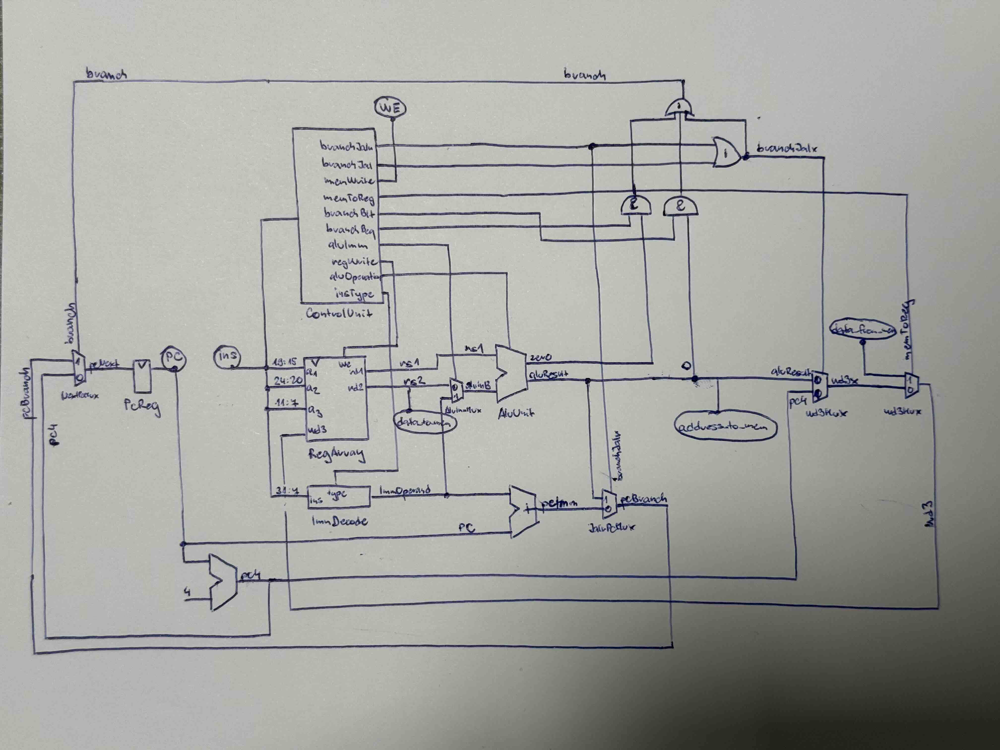

# RISC-V CPU

A single-cycle RISC-V processor written in Verilog, implementing a subset of the RV32I base instruction set plus two custom SIMD instructions for packed 8-bit vector arithmetic. Includes memory-mapped I/O, a simulation testbench, and sample programs, and has been run on a Basys 3 FPGA board.

- Single-cycle RV32I datapath (11 base instructions)
- Two custom instructions, `add_v` and `avg_v`, operating on four packed 8-bit signed lanes
- Memory-mapped I/O: a switch input and a seven segment (SSEG) display output
- Simulation testbench (Icarus Verilog) with a sample median-filter program
- FPGA top-level for the Digilent Basys 3 (Vivado)

## Supported instructions

| Instruction | Format  | Syntax                |
|---------|-------------|-----------------------|
| `add`   | R           | `add rd, rs1, rs2`    |
| `sub`   | R           | `sub rd, rs1, rs2`    |
| `and`   | R           | `and rd, rs1, rs2`    |
| `srl`   | R           | `srl rd, rs1, rs2`    |
| `addi`  | I           | `addi rd, rs1, imm`   |
| `lw`    | I           | `lw rd, imm(rs1)`     |
| `jalr`  | I           | `jalr rd, imm(rs1)`   |
| `sw`    | S           | `sw rs2, imm(rs1)`    |
| `beq`   | B           | `beq rs1, rs2, label` |
| `blt`   | B           | `blt rs1, rs2, label` |
| `jal`   | J           | `jal rd, label`       |
| `add_v` | R (custom)  | `add_v rd, rs1, rs2`  |
| `avg_v` | R (custom)  | `avg_v rd, rs1, rs2`  |

### Vector extension

`add_v` and `avg_v` treat each 32-bit register as a vector of four 8-bit signed values and operate on each lane independently:

```text
add_v rd, rs1, rs2                          avg_v rd, rs1, rs2

rd[31:24] <= rs1[31:24] + rs2[31:24]        rd[31:24] <= avg(rs1[31:24], rs2[31:24])
rd[23:16] <= rs1[23:16] + rs2[23:16]        rd[23:16] <= avg(rs1[23:16], rs2[23:16])
rd[15:8]  <= rs1[15:8]  + rs2[15:8]         rd[15:8]  <= avg(rs1[15:8],  rs2[15:8])
rd[7:0]   <= rs1[7:0]   + rs2[7:0]          rd[7:0]   <= avg(rs1[7:0],   rs2[7:0])
```

Both use the RISC-V custom-0 opcode (`0001011`).

### Instruction encoding

`rs1`, `rs2` and `rd` are 5-bit register indices.

| Instruction | [31:25]                 | [24:20]   | [19:15]   | [14:12]   | [11:7]        | [6:0]     |
|---------|-----------------------------|-----------|-----------|-----------|---------------|-----------|
| `add`   | `0000000`                   | rs2       | rs1       | `000`     | rd            | `0110011` |
| `sub`   | `0100000`                   | rs2       | rs1       | `000`     | rd            | `0110011` |
| `and`   | `0000000`                   | rs2       | rs1       | `111`     | rd            | `0110011` |
| `srl`   | `0000000`                   | rs2       | rs1       | `101`     | rd            | `0110011` |
| `addi`  | imm[11:5]                   | imm[4:0]  | rs1       | `000`     | rd            | `0010011` |
| `lw`    | imm[11:5]                   | imm[4:0]  | rs1       | `010`     | rd            | `0000011` |
| `jal`   | imm[20\|10:1\|11\|19:12]    | ...       | ...       | ...       | rd            | `1101111` |
| `jalr`  | imm[11:5]                   | imm[4:0]  | rs1       | `000`     | rd            | `1100111` |
| `sw`    | imm[11:5]                   | rs2       | rs1       | `010`     | imm[4:0]      | `0100011` |
| `beq`   | imm[12\|10:5]               | rs2       | rs1       | `000`     | imm[4:1\|11]  | `1100011` |
| `blt`   | imm[12\|10:5]               | rs2       | rs1       | `100`     | imm[4:1\|11]  | `1100011` |
| `add_v` | `0000000`                   | rs2       | rs1       | `000`     | rd            | `0001011` |
| `avg_v` | `0000000`                   | rs2       | rs1       | `001`     | rd            | `0001011` |

## Datapath



## Repository structure

```text
.
├── CPU.v          # processor: datapath, control unit, ALU, register file
├── top.v          # simulation top-level with instruction and data memory
├── CPU_tb.v       # testbench
├── scheme.jpg     # datapath schematic
├── examples/      # sample program for simulation: median filter
│   ├── median.asm
│   ├── memfile_inst.hex   # assembled program
│   └── memfile_data.hex   # initial data memory
└── fpga/          # Basys 3 build with memory-mapped I/O
    ├── top.v
    ├── constraints.xdc    # Vivado constraints file
    ├── display.asm        # sample program for synthesis: SSEG driven by `sw0`
    └── memfile_inst.hex   # assembled program
```

## Usage

### Simulation

Requires [Icarus Verilog](https://github.com/steveicarus/iverilog). `top.v` loads the program from `memfile_inst.hex` and the initial data memory from `memfile_data.hex` from the working directory, so run the simulation from the folder that contains them:

```sh
cd examples
iverilog ../CPU.v ../top.v ../CPU_tb.v -o out
./out
```

The sample program in `examples` is a median filter: it suppresses noise by replacing each element of an array with the median of itself and its two neighbours.

After the run:
- `test.vcd` contains the signal traces, viewable in a waveform viewer such as [GTKWave](https://gtkwave.sourceforge.net/).
- `memfile_data_after_simulation.hex` contains the final state of data memory (DMEM).

### FPGA with memory-mapped I/O

The top-level in `fpga/` maps the `sw0` input to a switch and `sseg_a` … `sseg_g` to the SSEG display of a Digilent Basys 3 board. It was built and tested with Vivado. To build it, create a Vivado project with `CPU.v`, `fpga/top.v` and the pin assignments in `fpga/constraints.xdc`.

| Address   | Direction | Meaning                                                       |
|-----------|-----------|---------------------------------------------------------------|
| `0x0`     | read      | `sw0` in bit 0                                                |
| `0x4`     | write     | segments in bits [6:0], `gfedcba` order, active low (`0` = on)|

This top-level only needs `memfile_inst.hex`. The sample program `display.asm` shows `0` or `1` on the display according to the switch.

## Acknowledgements

The top-level modules (top.v, fpga/top.v) and the testbench (CPU_tb.v) are adapted from materials provided in the BI-APS course at CTU in Prague. The processor in CPU.v, the vector extension, the memory-mapped I/O and the sample programs are my own work.